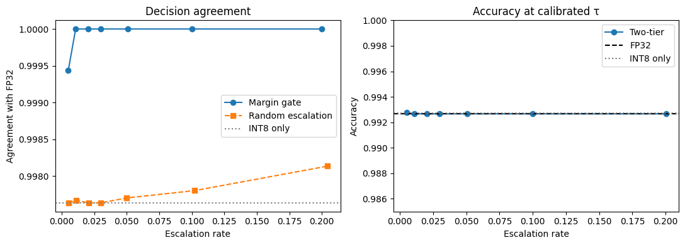

# Two-tier face verification: INT8 first, FP32 only when needed

A cheap INT8 ArcFace-R50 model scores every face pair. Only pairs whose score falls close to the
decision threshold (the "margin") are re-checked with the FP32 model, so FP32 cost is paid on a
small fraction of pairs.

*Left: agreement of two-tier decisions with FP32 decisions vs. the fraction of pairs escalated to
FP32 (mean of 10 random calibration/test splits; the y-axis spans only 0.25 percentage points).
The margin gate reaches 100% agreement at about 1% escalation; random escalation at the same budget
barely improves on INT8 alone. Right: accuracy at the calibrated threshold is the same for FP32,
INT8-only and two-tier (the INT8-only line is hidden beneath the FP32 line).*

## Results (LFW, 6000 pairs, ArcFace-R50 `w600k_r50`, CPU, 10 random 50/50 calibration/test splits)

| | FP32 | INT8 only | Two-tier (1% escalated) |
|---|---|---|---|
| Model size | 174.4 MB | 44.0 MB (~4.0x smaller) | 44.0 MB + 174.4 MB |
| AUC | 0.99942 | 0.99941 | n/a |
| TAR at the 1% FAR target | 99.79% | 99.74% | 99.79% |
| Measured FAR (target 1%) | 1.25% | 1.20% | 1.25% |
| Agreement with FP32 decisions | 100% | 99.76% | **100.00%** (all 10 splits) |
| Est. latency per pair (Colab CPU) | 787 ms | 387 ms | ~395 ms |

Escalation budget sweep (fraction of pairs sent to FP32):

| Budget | Agreement with FP32 | Random escalation | Est. latency / pair | vs. FP32-only |
|---|---|---|---|---|
| 0.5% | 99.94% | 99.76% | 391 ms | 50% faster |
| 1% | 100.00% | 99.77% | 395 ms | 50% faster |
| 2% | 100.00% | 99.76% | 403 ms | 49% faster |
| 5% | 100.00% | 99.77% | 427 ms | 46% faster |
| 10% | 100.00% | 99.78% | 466 ms | 41% faster |
| 20% | 100.00% | 99.81% | 544 ms | 31% faster |

Break-even escalation rate (two-tier no faster than FP32-only): about 51%.

Full tables: `results/summary_mean.csv` (means), `results/summary_std.csv` (std across splits),
`results/all_splits.csv` (per split).

### How to read these numbers
- INT8 and FP32 disagree on only 12 of 6000 pairs (thresholds fit on all pairs); all 12 lie within
  the 0.77% of pairs closest to the INT8 threshold. That is why a ~1% budget suffices here.
- Differences in TAR/FAR/accuracy between systems are within split-to-split noise
  (std about 0.1% TAR, 0.4% FAR). The solid findings are the agreement numbers and the
  margin-vs-random contrast, not an accuracy gain.
- Latency is an estimate: `c1 + escalation * c2`, using separately timed per-pair costs
  (c1 = 387 ms INT8, c2 = 787 ms FP32), not a measured end-to-end pipeline. Absolute times vary a
  lot between Colab sessions (FP32 per pair measured 787-1172 ms across runs); trust the roughly
  2x INT8/FP32 ratio more than the milliseconds. Detection/alignment cost is not included.

## Limitations
- One dataset (LFW, an easy benchmark) and 12 disagreeing pairs: "about 1% suffices" is an
  empirical LFW result, not a guarantee. Harder data (cross-pose, low quality) is untested.
- The gate is a margin heuristic around the threshold. It is not an attack or spoof detector.
- The INT8 model is only validated on face verification quality (embedding cosine, AUC, agreement).

## Quantization notes (what it took to get INT8 working)
- The InsightFace model is ONNX opset 11; per-channel QDQ quantization needs opset 13 (the
  notebook converts it).
- On CPUs without VNNI (typical Colab Xeon: AVX2 only), the default u8 x s8 kernels can saturate.
  Plain static quantization gave a mean embedding cosine of 0.79-0.84 against FP32; adding
  `reduce_range=True` or using u8 weights gave about 0.989. A weight-only int8 simulation scored
  0.9998, which pointed to activations/kernels rather than the weights.
- The chosen variant is `w_u8_a_u8` (QDQ, per-channel, MinMax calibration, 100 calibration images
  taken from the calibration side of split 0, never from test pairs). See `results/quant_report.json`.

## Reproduce
1. Obtain `w600k_r50.onnx` (InsightFace `buffalo_l` model pack) and `lfw.bin` (aligned LFW pairs,
   112x112, InsightFace format). Neither is included in this repo.
2. Put both files in a Drive folder, e.g. `/content/drive/MyDrive/CS228` (or change `PROJECT_DIR`
   in the config cell).
3. Open `two_tier_face_verification.ipynb` in Google Colab with the runtime set to **CPU**
   (no GPU/TPU: the code uses ONNX Runtime's CPU provider and the INT8 latency is CPU-specific).
4. Run the cells top to bottom. A full 6000-pair run takes roughly 2 hours on a 2-vCPU Colab
   runtime (FP32 scoring about 88 min, INT8 about 41 min); scores are cached in
   `results/embeddings.npz`. Set `N_PAIRS = 600` for a quick smoke test.

Dependencies: `requirements.txt` (the notebook installs what it needs on Colab).

## Files
- `two_tier_face_verification.ipynb` (and `.py` export): quantize, score, evaluate, plot
- `results/`: summary CSVs, per-split results, `meta.json`, `quant_report.json`, plot, cached scores
  (`embeddings.npz` holds only the FP32/INT8 pair scores and labels, so the evaluation can be re-run
  without the models)

## Licensing
Model weights and LFW data have their own licenses (InsightFace models are for non-commercial
research use). They are deliberately not redistributed here.
